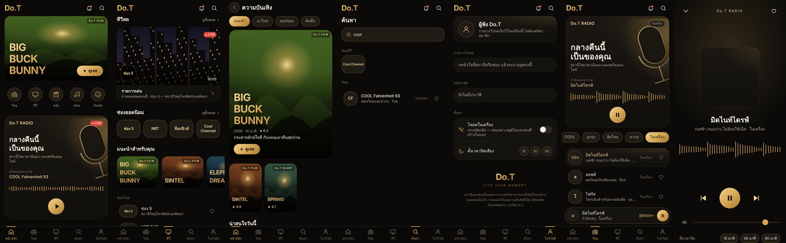

# Do.T — Radio · TV · Entertainment

ฟัง · ดู · สนุก ครบจบในที่เดียว — แอปวิทยุ ทีวีสด และหนัง สำหรับ **Android และ iPhone**
สร้างด้วย React + Vite แล้วห่อเป็นแอปเนทีฟด้วย [Capacitor](https://capacitorjs.com)



## ฟีเจอร์

- **วิทยุ** — คลื่นไทย (COOL, Flex, ลูกทุ่ง, MCOT ฯลฯ) + สถานีต่างประเทศ (SomaFM) + สตูดิโอสร้างเสียงในเครื่อง 6 สถานีที่เล่นได้แม้ไม่มีเน็ต
- **ทีวีสด** — ช่อง 5, NBT, ท็อปนิวส์, Cool Channel, DLTV, NASA TV ฯลฯ (HLS) + ช่องภาพในเครื่อง
- **ความบันเทิง** — ภาพยนตร์ลิขสิทธิ์เปิด (Blender) + คลิป "คิดสั้น" แนวตั้ง
- ค้นหารวม, รายการโปรด/เล่นล่าสุด, ตั้งเวลาปิดเสียง, โหมดในเครื่อง, ปุ่ม Back ของ Android

## เริ่มพัฒนา

```bash
npm install
npm run dev          # เปิดในเบราว์เซอร์ http://localhost:5173
```

## สร้างแอปมือถือ

ครั้งแรก (สร้างโฟลเดอร์ android/ และ ios/):

```bash
npm run build
npm run native:add   # cap add android + ios แล้วแพตช์ background audio / cleartext
npm run assets       # สร้างไอคอนและ splash จาก resources/
```

จากนั้นทุกครั้งที่แก้โค้ด:

```bash
npm run android      # build + sync + เปิด Android Studio → กด Run
npm run ios          # build + sync + เปิด Xcode (ต้องใช้ Mac) → กด Run
```

### ไม่มีเครื่อง build? ใช้ GitHub Actions

- **Android APK**: ทุกครั้งที่ push ขึ้น `main` workflow *Android APK* จะ build ให้ —
  ไปที่แท็บ **Actions → Android APK → run ล่าสุด → Artifacts → DoT-debug-apk** ดาวน์โหลดแล้วติดตั้งในมือถือได้เลย
- **iOS**: workflow *iOS build check* คอมไพล์ให้บน simulator เพื่อตรวจว่าโค้ดไม่พัง
  การติดตั้งลง iPhone จริง/TestFlight ต้องมี Apple Developer account ($99/ปี) และตั้งค่า signing ใน Xcode

## โครงสร้าง

```
src/
  components/   หน้าจอ (home, radio, tv, movies, search, profile), ตัวเล่น, ไอคอน
  lib/
    catalog.ts  รายชื่อสถานี ช่อง หนัง คลิป
    engine.ts   สตูดิโอสร้างเสียงด้วย Web Audio (ออฟไลน์)
    player.ts   ตัวเล่นวิทยุ + fallback เมื่อสตรีมล่ม
    store.ts    state (zustand) + เก็บค่าในเครื่อง
    native.ts   status bar, splash, ปุ่ม back
capacitor.config.ts
scripts/patch-native.mjs
```

## สิ่งที่เปลี่ยนจากโค้ดเดิม (Grok workspace)

| เดิม | ตอนนี้ |
|---|---|
| TanStack Start + SSR + Nitro + Vercel | Vite SPA → Capacitor (ไฟล์อยู่ในแอป เปิดเร็ว ใช้ออฟไลน์ได้) |
| ระบบ login / PGlite / Postgres / multiplayer ที่ UI ไม่ได้ใช้ | ตัดออก (ลด dependency ~60 ตัว) |
| สคริปต์ sandbox ของ Grok, preview bridge, service worker | ตัดออก |
| ฟอนต์ Outfit/Syne (ไม่มีอักษรไทย) | Prompt (ไทย+อังกฤษ) |
| ธีมขาว-ดำ, 4 แท็บ | ธีมดำ-ทองตามแบบ, 5 แท็บ + หน้าความบันเทิง |
| lucide-react | ไอคอน SVG ของแอปเอง |
| หนังปนอยู่ในรายการช่องทีวี | แยกเป็นแคตตาล็อกหนัง + ตัวเล่นเต็มจอที่ใช้ร่วมกับทีวี |
| iOS: hls.js อย่างเดียว | ใช้ HLS เนทีฟบน iOS, hls.js บน Android |

## หมายเหตุเรื่องคอนเทนต์

ช่อง 3, ช่อง 7, ช่องวัน, Thai PBS และหนัง/ซีรีส์จาก HBO, Netflix ฯลฯ **ไม่สามารถใส่ได้** หากไม่มีสัญญาอนุญาต
(สถานีเหล่านี้ไม่เปิดสตรีมให้แอปอื่นดึง และหนังเชิงพาณิชย์ต้องมีสิทธิ์ + DRM) ภาพโปสเตอร์ในแอปจึงเป็นงานกราฟิกที่สร้างขึ้นเอง
ถ้าได้สิทธิ์แล้ว เพิ่มรายการใน `src/lib/catalog.ts` ได้ทันที

## แผนต่อไป

- [ ] ควบคุมเสียงจากหน้าล็อก / Control Center (Media Session + `@capgo/capacitor-media-session`)
- [ ] เก็บค่าด้วย `@capacitor/preferences` แทน localStorage
- [ ] โหลดรายชื่อสถานี/ช่องจาก API แทน hard-code + ตรวจสตรีมที่ล่มอัตโนมัติ
- [ ] Chromecast / AirPlay สำหรับทีวี
- [ ] บัญชีผู้ใช้ + ซิงก์รายการโปรดข้ามเครื่อง
- [ ] Release build ที่ลงชื่อแล้วสำหรับ Play Store / App Store
