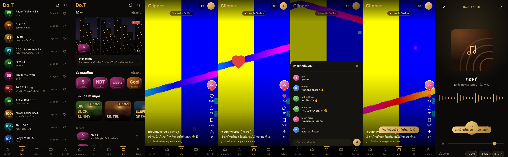

# Do.T — Radio · TV · Entertainment

ฟัง · ดู · สนุก ครบจบในที่เดียว — แอปวิทยุ ทีวีสด และหนัง สำหรับ **Android และ iPhone**
สร้างด้วย React + Vite แล้วห่อเป็นแอปเนทีฟด้วย [Capacitor](https://capacitorjs.com)

**🌐 เว็บ:** https://mengnattawitmarin.github.io/dot-app/
**📱 Android APK:** https://github.com/mengnattawitmarin/dot-app/releases/latest/download/DoT.apk



## ฟีเจอร์

- **วิทยุ** — คลื่นไทยหลายร้อยสถานีจาก [Radio Browser](https://www.radio-browser.info) (โหลดตอนเปิดแอป + เก็บแคช) รวมกับคลื่นที่คัดไว้ (COOL, Flex, MCOT ฯลฯ), สถานีต่างประเทศ (SomaFM) และสตูดิโอในเครื่อง 6 สถานี — ค้นหา, กรอง FM 88–108 เรียงตามคลื่น, ลูกทุ่ง, ข่าว
- **เรื่องเล่า** — พอดแคสต์ไทยสาธารณะแยกหมวด: สยองขวัญ, เรื่องเล่า, คดี & ลึกลับ, ความรู้, ประวัติศาสตร์, นิยายเสียง, ภาพยนตร์ & ละครเสียง, พัฒนาตัวเอง, ธุรกิจ, ธรรมะ — จำตำแหน่งที่ฟังค้าง, ข้าม ±15/30 วิ, ปรับความเร็ว, ติดตามรายการ, ปุ่มบนหน้าล็อก (รายการตอนใหม่ดึงทุกวันด้วย `scripts/fetch-podcasts.mjs`)
- **สถานีโปรด** — กด ♡ แล้วขึ้นแถบสถานีโปรดในหน้าหลักและหน้าวิทยุ + ตัวกรอง ★ โปรด
- **ตัดต่อวิดีโอ (แทน CapCut)** — ทำในเครื่องทั้งหมด
  - *Auto*: เลือกคลิป/รูป + เพลง → หาช่วงที่เคลื่อนไหวมากที่สุด, จับจังหวะเพลง, ตัดตามบีท, 5 สไตล์ (บีทมันส์ / ชิล / ภาพยนตร์ / วล็อก / ย้อนวัย), ไตเติลอัตโนมัติ
  - *Manual*: ตัด/แยก/เรียง/ทำซ้ำ/ลบ, ความเร็ว 0.25–3×, เสียงต่อคลิป, รูปเคลื่อนไหว (ซูม/แพน), ข้อความ 5 สไตล์ + 6 แอนิเมชัน + 4 ฟอนต์ ลากวางได้, สติกเกอร์, ฟิลเตอร์ 10 แบบ, ปรับแสง/สี, ทรานสิชัน 5 แบบ, เพลง + เฟดออก, ซูมตามบีท, แถบหนัง, เกรนฟิล์ม, ขอบมืด, วันที่ย้อนยุค, 9:16/4:5/1:1/16:9, พื้นหลังเบลอ, ย้อนกลับ/ทำซ้ำ
  - ส่งออก 720p → บันทึกลงเครื่อง, แชร์ไป TikTok/LINE/IG, หรือโพสต์ลง Clipper
- **Clipper** — วิดีโอสั้นแนวตั้งแบบรีลส์: เลื่อนขึ้นลง, เล่นอัตโนมัติ, แตะหยุด, แตะสองครั้งถูกใจ, คอมเมนต์, แชร์, บันทึก, ติดตาม และเพิ่มคลิปจากกล้อง/แกลเลอรีของตัวเอง (เก็บในเครื่อง)
- **ระบบออนไลน์ (Supabase + Firebase)** — เข้าสู่ระบบด้วยอีเมล + รหัสผ่าน, โพสต์คลิปสาธารณะ, ถูกใจ/คอมเมนต์จริง, รายงานคลิป (ครบ 3 รายงานซ่อนอัตโนมัติ), ซิงก์รายการโปรดทุกเครื่อง, กล่องแจ้งเตือน และ push notification — **วิธีตั้งค่า: [docs/BACKEND.md](docs/BACKEND.md)**
- **ภาพปก** — ทุกสถานีและช่องมีอาร์ตเวิร์กสีประจำตัวพร้อมเลขคลื่น/เลขช่อง (สร้างขึ้นเอง ไม่ใช้โลโก้ของสถานี)
- **ทีวีสด** — ช่อง 5, NBT, ท็อปนิวส์, Cool Channel, DLTV, NASA TV ฯลฯ (HLS) + ช่องภาพในเครื่อง
- **ความบันเทิง** — ภาพยนตร์ลิขสิทธิ์เปิด (Blender) + คลิป "คิดสั้น" แนวตั้ง
- ค้นหารวม, รายการโปรด/เล่นล่าสุด, ตั้งเวลาปิดเสียง, โหมดในเครื่อง, ปุ่ม Back ของ Android
- **ชื่อเพลงที่กำลังเล่น** (Android) — อ่าน ICY metadata จากสตรีม Icecast/SHOUTcast ทุก 15 วินาที รองรับภาษาไทย UTF-8 และ TIS-620 แสดงในการ์ดวิทยุ แถบเพลง หน้ากำลังเล่น และหน้าล็อก
- **เปิดเพลงในแอปอื่น / แชร์** — จากชื่อเพลงที่กำลังเล่น กดเปิดใน Apple Music, Spotify, YouTube Music, YouTube, TikTok หรือค้นเนื้อเพลง และแชร์ผ่าน LINE/Facebook/ฯลฯ พร้อมลิงก์ที่เปิดสถานีนั้นใน Do.T ได้ทันที
- **Player บนหน้าล็อก** — Android: การ์ดเพลงบนหน้าล็อกและแถบแจ้งเตือน (native media service, ภาพปกสถานี, ก่อนหน้า/เล่น/ถัดไป) และเล่นต่อเนื่องตอนล็อกจอ · iPhone/เว็บ: Media Session
- ส่งวิดีโอขึ้นทีวีด้วย AirPlay (iPhone) หรือ Cast (Chrome)
- ย้ายรายการโปรดข้ามเครื่องด้วยโค้ด `DOT1-…` ไม่ต้องสมัครสมาชิก
- อัปเดตรายชื่อสถานีได้โดยไม่ต้องออกเวอร์ชันใหม่ (`public/catalog.json`) และซ่อนสตรีมที่ล่มอัตโนมัติทุกวัน

## เริ่มพัฒนา

```bash
npm install
npm run dev          # เปิดในเบราว์เซอร์ http://localhost:5173
```

## สร้างแอปมือถือ

ครั้งแรก (สร้างโฟลเดอร์ android/ และ ios/):

```bash
npm run build
npm run native:add   # cap add android + ios แล้วแพตช์ background audio / cleartext
npm run assets       # สร้างไอคอนและ splash จาก resources/
```

จากนั้นทุกครั้งที่แก้โค้ด:

```bash
npm run android      # build + sync + เปิด Android Studio → กด Run
npm run ios          # build + sync + เปิด Xcode (ต้องใช้ Mac) → กด Run
```

### ไม่มีเครื่อง build? ใช้ GitHub Actions

- **Android APK**: ทุกครั้งที่ push ขึ้น `main` workflow *Android APK* จะ build ให้ —
  ไปที่แท็บ **Actions → Android APK → run ล่าสุด → Artifacts → DoT-debug-apk** ดาวน์โหลดแล้วติดตั้งในมือถือได้เลย
- **iOS**: workflow *iOS build check* คอมไพล์ให้บน simulator เพื่อตรวจว่าโค้ดไม่พัง
  การติดตั้งลง iPhone จริง/TestFlight ต้องมี Apple Developer account ($99/ปี) และตั้งค่า signing ใน Xcode

## โครงสร้าง

```
src/
  components/   หน้าจอ (home, radio, tv, movies, search, profile), ตัวเล่น, ไอคอน
  lib/
    catalog.ts  รายชื่อสถานี ช่อง หนัง คลิป
    engine.ts   สตูดิโอสร้างเสียงด้วย Web Audio (ออฟไลน์)
    player.ts   ตัวเล่นวิทยุ + fallback เมื่อสตรีมล่ม
    store.ts    state (zustand) + เก็บค่าในเครื่อง
    native.ts   status bar, splash, ปุ่ม back
capacitor.config.ts
scripts/patch-native.mjs
```

## สิ่งที่เปลี่ยนจากโค้ดเดิม (Grok workspace)

| เดิม | ตอนนี้ |
|---|---|
| TanStack Start + SSR + Nitro + Vercel | Vite SPA → Capacitor (ไฟล์อยู่ในแอป เปิดเร็ว ใช้ออฟไลน์ได้) |
| ระบบ login / PGlite / Postgres / multiplayer ที่ UI ไม่ได้ใช้ | ตัดออก (ลด dependency ~60 ตัว) |
| สคริปต์ sandbox ของ Grok, preview bridge, service worker | ตัดออก |
| ฟอนต์ Outfit/Syne (ไม่มีอักษรไทย) | Prompt (ไทย+อังกฤษ) |
| ธีมขาว-ดำ, 4 แท็บ | ธีมดำ-ทองตามแบบ, 5 แท็บ + หน้าความบันเทิง |
| lucide-react | ไอคอน SVG ของแอปเอง |
| หนังปนอยู่ในรายการช่องทีวี | แยกเป็นแคตตาล็อกหนัง + ตัวเล่นเต็มจอที่ใช้ร่วมกับทีวี |
| iOS: hls.js อย่างเดียว | ใช้ HLS เนทีฟบน iOS, hls.js บน Android |

## หมายเหตุเรื่องคอนเทนต์

ช่อง 3, ช่อง 7, ช่องวัน, Thai PBS และหนัง/ซีรีส์จาก HBO, Netflix ฯลฯ **ไม่สามารถใส่ได้** หากไม่มีสัญญาอนุญาต
(สถานีเหล่านี้ไม่เปิดสตรีมให้แอปอื่นดึง และหนังเชิงพาณิชย์ต้องมีสิทธิ์ + DRM) ภาพโปสเตอร์ในแอปจึงเป็นงานกราฟิกที่สร้างขึ้นเอง
ถ้าได้สิทธิ์แล้ว เพิ่มรายการใน `src/lib/catalog.ts` ได้ทันที

## ระบบอัตโนมัติ (GitHub Actions)

| Workflow | ทำอะไร |
|---|---|
| **Deploy web** | push ขึ้น `main` → build แล้ว deploy เว็บไป branch `gh-pages` |
| **Android APK** | push ขึ้น `main` → build APK แล้วออก Release ใหม่ (ลิงก์ดาวน์โหลดด้านบนชี้ไปตัวล่าสุดเสมอ) |
| **iOS build check** | คอมไพล์แอป iOS บน simulator เพื่อตรวจว่าโค้ดไม่พัง |
| **Backend (Supabase)** | เมื่อแก้โฟลเดอร์ `supabase/` → อัปเดตฐานข้อมูล + deploy ฟังก์ชัน push (ข้ามเองถ้ายังไม่ใส่ secrets) |
| **Stream health** | ทุกวัน 04:17 ตรวจทุกสตรีม แล้วเขียน `stream-status.json` — แอปที่ติดตั้งแล้วจะซ่อนช่องที่ล่มเอง |

### เพิ่ม/แก้สถานีโดยไม่ต้องออกเวอร์ชันใหม่

แก้ `public/catalog.json` (รูปแบบเดียวกับ `src/lib/catalog.ts`) แล้ว push — แอปทุกเครื่องจะโหลดรายการใหม่ตอนเปิดครั้งถัดไป

### ลงชื่อแอปสำหรับ Play Store

สร้าง keystore ครั้งเดียว:

```bash
keytool -genkey -v -keystore dot-release.jks -alias dot -keyalg RSA -keysize 2048 -validity 10000
base64 -w0 dot-release.jks   # คัดลอกผลลัพธ์
```

แล้วเพิ่ม secrets ใน repo (Settings → Secrets and variables → Actions):
`ANDROID_KEYSTORE_BASE64`, `ANDROID_KEYSTORE_PASSWORD`, `ANDROID_KEY_ALIAS`, `ANDROID_KEY_PASSWORD`
จากนั้น Release จะมี `DoT.apk` ที่ลงชื่อแล้ว + `DoT.aab` สำหรับอัปโหลด Play Console
(**เก็บไฟล์ .jks ไว้ให้ดี** — ถ้าหายจะอัปเดตแอปบน Play Store ไม่ได้อีก)

## แผนต่อไป

- [x] ควบคุมเสียงจากหน้าล็อก (Media Session — สถานีสด)
- [x] เก็บค่าด้วย `@capacitor/preferences`
- [x] รายชื่อสถานีจากออนไลน์ + ตรวจสตรีมล่มอัตโนมัติ
- [x] AirPlay / Cast
- [x] ย้ายรายการโปรดข้ามเครื่อง (โค้ด)
- [x] Release build ที่ลงชื่อได้ (เมื่อใส่ keystore)
- [x] คลื่นไทยเพิ่มจาก Radio Browser
- [x] Clipper วิดีโอสั้น
- [x] บัญชีผู้ใช้ + โพสต์คลิปสาธารณะ + ซิงก์ (Supabase) — รอใส่ค่าโปรเจกต์ตาม docs/BACKEND.md
- [x] Push notification (Firebase) — รอใส่ google-services.json
- [ ] หน้า Terms / Privacy ก่อนส่งขึ้น Play Store
- [ ] ปุ่มควบคุมบนหน้าล็อกสำหรับสตูดิโอในเครื่อง (ต้องใช้ native audio plugin)
- [ ] TestFlight / App Store — ต้องมี Apple Developer account
